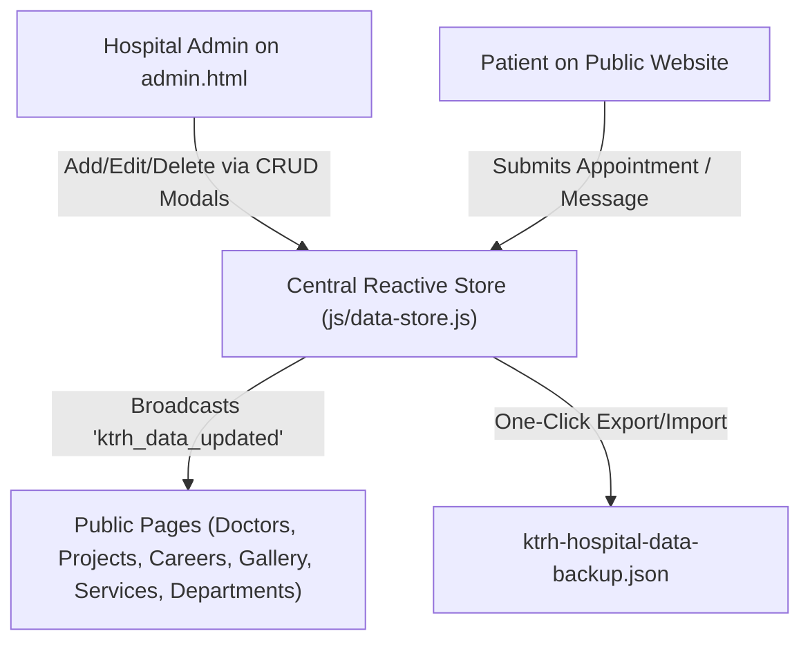

# Kisii Teaching & Referral Hospital (KTRH) — Official Web Portal

[](https://developer.mozilla.org/en-US/docs/Web/HTML)
[](https://developer.mozilla.org/en-US/docs/Web/CSS)
[](https://developer.mozilla.org/en-US/docs/Web/JavaScript)
[](./admin.html)
[](https://vercel.com/)
[](https://web.dev/progressive-web-apps/)

> Modern, responsive, and accessible web portal for **Kisii Teaching & Referral Hospital (KTRH)** — delivering comprehensive healthcare information, dynamic medical staff directories, appointment scheduling, development project tracking, career applications, and an integrated staff **Hospital Administration Control Center**.

---

##  Table of Contents

- [Overview](#-overview)
- [Key Features](#-key-features)
- [Tech Stack](#-tech-stack)
- [Project Structure](#-project-structure)
- [Pages & Modules](#-pages--modules)
- [Hospital Administration Portal & Data Engine](#-hospital-administration-portal--data-engine)
  - [Accessing the Admin Portal](#accessing-the-admin-portal)
  - [Administrative Modules](#administrative-modules)
  - [Real-Time Data Architecture](#real-time-data-architecture)
  - [Image Uploads & Local Persistence](#image-uploads--local-persistence)
  - [Data Backup, Restore & Sync](#data-backup-restore--sync)
- [Getting Started](#-getting-started)
  - [Prerequisites](#prerequisites)
  - [Installation & Local Run](#installation--local-run)
- [Deployment](#-deployment)
- [Performance & PWA](#-performance--pwa)
- [Contributing](#-contributing)
- [License & Contact](#-license--contact)

---

##  Overview

**Kisii Teaching & Referral Hospital (KTRH)** is a leading tertiary healthcare and medical training institution located in Kisii, Western Kenya. This web platform provides patients, healthcare professionals, students, and the community with digital access to hospital services, clinical department guides, medical staff directories, appointment booking, career openings, and capital modernization milestones.

The portal operates on a **self-contained, serverless architecture** built with modern vanilla web standards and a dedicated **KTRH Admin Dashboard (`admin.html`)** powered by a central reactive data engine (`js/data-store.js`). Hospital staff can manage doctors, projects, services, jobs, gallery photos, and patient bookings directly in real time without external CMS dependencies.

---

##  Key Features

- **Dedicated Hospital Admin Dashboard (`admin.html`)**: Passcode-protected control center allowing hospital administrators to add, edit, or remove doctors, infrastructure projects, clinical services, department info, job vacancies, and media items.
- **Real-Time Data Synchronization**: Built-in reactive data engine (`js/data-store.js`) broadcasting instant updates across all public pages via browser custom events (`ktrh_data_updated`) without requiring server redeployments or page reloads.
- **Interactive Doctor Directory**: Dynamic medical staff listings with search by doctor name or specialty, departmental filtering, qualification cards, and modal bio previews.
- **Online Appointment Booking**: Interactive appointment scheduling with dynamic department-to-doctor assignment, automated future date/time slot validation, Kenyan phone formatting (`+254`), and modal confirmation with auto-generated tracking reference codes. All submissions log directly into the Admin Portal in real time.
- **Infrastructure & Project Showcase**: Dynamic project portfolio tracking hospital modernization, capacity expansion, and community healthcare initiatives with categorization (Ongoing, Completed, Upcoming, Research, Infrastructure).
- **Careers & Recruitment Portal**: Live vacancy listings, deadline tracking, role criteria, and an interactive application modal with document upload (CV/Resume & certificates) plus general talent submissions.
- **Multimedia Gallery**: Categorized media stream (Events, Facilities, Team, Achievements, Community, Videos) with modal lightbox previews and video playback integration.
- **Patient Inquiry & Message Center**: Public contact form messages and newsletter signups are captured immediately into the Admin Portal for hospital staff review.
- **Local Media & Image Support**: Supports both external image URLs and direct local image file uploads (automatically encoded as Base64 Data URLs) for instant rendering across the portal.
- **JSON Backup & Restore**: One-click database export and restore functionality allowing admins to safely back up hospital data, sync data between devices, or reset to factory defaults.
- **Mobile-First & Responsive UI**: Custom CSS grid and flexbox architecture designed for seamless browsing on phones, tablets, and desktop displays.
- **PWA Baseline**: Integrated Service Worker (`sw.js`) and Web App Manifest (`site.webmanifest`) for progressive web app baseline capabilities.

---

##  Tech Stack

| Layer | Technology | Description |
|---|---|---|
| **Structure** | HTML5 | Semantic markup, accessible forms, meta tags & SEO structure |
| **Styling** | Vanilla CSS3 | Custom modular stylesheets per page, responsive grids, flexbox & animations |
| **Interactivity** | Vanilla JavaScript (ES6+) | Asynchronous data flows, DOM manipulation, modal controllers, form validation |
| **Administration** | KTRH Admin Portal (`admin.html`) | Full-featured hospital dashboard with passcode security and CRUD managers |
| **Data Engine** | KTRH Central Store (`js/data-store.js`) | Local persistent reactive store with Base64 image encoding and JSON backup/sync |
| **Icons & Fonts** | Font Awesome 6 & Google Fonts | Poppins, Open Sans typography and comprehensive UI iconography |
| **Deployment** | Vercel | Production CDN hosting with clean URLs, asset rewrites, and CORS headers |

---

##  Project Structure

```text
KTRH-FRONTEND/
├── about.html            # About KTRH: History, Leadership, Mission & Values
├── admin.html            # Hospital Staff Administration Dashboard
├── appointment.html      # Patient appointment booking portal
├── careers.html          # Job openings, criteria, and online application modal
├── contact.html          # Contact details, emergency lines, inquiry form & mapGo with the Self-Contained Local Admin (Option C): We build the complete admin dashboard right now inside the repository with localStorage and JSON data
├── departments.html      # Specialized clinical & administrative departments
├── doctors.html          # Medical staff directory with live search & filters
├── gallery.html          # Facility & event photo/video gallery with lightbox
├── index.html            # Main homepage (Hero, Stats, Services, Featured Doctors)
├── projects.html         # Hospital modernization & community projects
├── services.html         # Comprehensive medical & diagnostic services catalog
├── sw.js                 # Service worker script (PWA baseline pass-through)
├── vercel.json           # Vercel routing, rewrite rules, and security headers
├── css/                  # Modular stylesheets
│   ├── about.css
│   ├── admin.css         # Admin dashboard styles & modal controls
│   ├── appointment.css
│   ├── careers.css
│   ├── departments.css
│   ├── doctors.css
│   ├── gallery.css
│   ├── projects.css
│   ├── services.css
│   └── style.css         # Global core stylesheet (Header, Footer, Utilities)
├── js/                   # Client-side JavaScript modules
│   ├── about.js          # About page initializers and timeline hooks
│   ├── admin.js          # Admin dashboard controller, CRUD & auth handlers
│   ├── appointment.js    # Appointment scheduling, validation & central store sync
│   ├── careers.js        # Dynamic jobs loader, filters & application forms
│   ├── data-store.js     # Central persistent hospital database & reactive store
│   ├── departments.js    # Dynamic departments loader & detail modals
│   ├── doctors.js        # Dynamic medical team loader, search & filters
│   ├── gallery.js        # Gallery logic, category management & lightbox
│   ├── home.js           # Homepage dynamic stats, featured doctors & forms
│   ├── projects.js       # Projects renderer, statistics & detail modals
│   ├── script.js         # Global navigation, animations, preloader & chat widget
│   ├── services.js       # Medical services catalog loader & search
│   └── sw.js             # Standalone service worker module
├── img/                  # Logos, banners, medical imagery, and static assets
│   └── favicon_io3/      # App icons, favicon bundle & site.webmanifest
└── assets/               # Additional media files and doctor imagery
```

---

##  Pages & Modules

| Page | File | Key Capabilities |
|---|---|---|
| **Admin Portal** | [`admin.html`](./admin.html) | Passcode-protected hospital management dashboard (Doctors, Projects, Services, Departments, Jobs, Gallery, Appointments, Inquiries, Backup) |
| **Home** | [`index.html`](./index.html) | Hero slider with YouTube video embed, live statistics counter, emergency banner, featured services, dynamic doctors showcase, newsletter subscription |
| **About** | [`about.html`](./about.html) | Institutional history, core values, board & leadership profiles, accreditation, mission & vision |
| **Services** | [`services.html`](./services.html) | Live medical & diagnostic services catalog, categorized filters, search, service details modal |
| **Departments** | [`departments.html`](./departments.html) | Clinical departments, department heads, service breakdown, phone extensions, appointment links |
| **Doctors** | [`doctors.html`](./doctors.html) | Medical staff directory, specialty & name search, department filters, doctor profile modals |
| **Appointments** | [`appointment.html`](./appointment.html) | Interactive appointment booking, dynamic department-to-doctor assignment, date/time validation, booking confirmation modal |
| **Projects** | [`projects.html`](./projects.html) | Capital development projects, status badges (Ongoing, Completed, Upcoming), statistics counter, project details modal |
| **Careers** | [`careers.html`](./careers.html) | Live job vacancies, application deadline calculator, job details modal, online application form with document upload (CV/Certificates) |
| **Gallery** | [`gallery.html`](./gallery.html) | Categorized photo & video stream, search, responsive modal lightbox, video player modal, view counter |
| **Contact** | [`contact.html`](./contact.html) | Google Maps embed, direct emergency dialers, departmental contacts, interactive inquiry submission form |

---

## 🛠️ Hospital Administration Portal & Data Engine

The website features an integrated, self-contained **Hospital Administration Control Center (`admin.html`)** that allows KTRH staff to manage and update all non-hardcoded hospital information in real time.



### Accessing the Admin Portal

1. Navigate to `/admin.html` (or click **Staff Admin Portal** in the homepage footer).
2. Enter the admin passcode. 
   - **Default Passcode**: `ktrh2026`
   - *Admins can update the passcode anytime from the "Data Backup & Settings" tab.*

### Administrative Modules

1. **Dashboard Overview**: Live KPI counters for total doctors, active infrastructure projects, job vacancies, media items, pending patient appointments, and unread inquiries.
2. **Doctors & Staff**:
   - Add new doctors or edit existing profiles (Name, Title, Department, Specialty, Experience, Consultation Hours, Bio, Qualifications).
   - Upload doctor headshots directly from your device (stored as Base64) or paste an image URL.
   - Toggle homepage feature status.
3. **Projects & Works**:
   - Track modernization and capital projects (e.g., Cancer Care Center, Mother & Child Hospital).
   - Update project progress percentage with an interactive slider (0–100%), adjust budgets, contractor info, and status badges.
4. **Clinical Services**:
   - Manage clinical and diagnostic service offerings, descriptions, operating hours, Font Awesome icons, and procedures.
5. **Departments**:
   - Maintain clinical divisions, assign heads of departments, update phone extensions, and manage service lists.
6. **Careers & Recruitment**:
   - Publish new job vacancies with department tags, role criteria, and deadlines.
   - Toggle vacancy status between **Active** and **Paused**.
7. **Media & Gallery**:
   - Add photo and video items categorized by Facilities, Events, Team, Achievements, Community, or Videos.
   - Embed YouTube videos or upload local images.
8. **Patient Appointments Log**:
   - View patient bookings submitted from `appointment.html` (Reference #, Patient Name, Phone, Date, Time, Department, Doctor, Symptoms).
   - Update booking status: **Confirmed**, **Completed**, or **Cancelled**.
9. **Patient Inquiries & Messages**:
   - Review incoming inquiries sent through `contact.html` and the homepage contact form.
   - Mark messages as **Read** or remove them.
10. **Data Backup & Settings**:
    - **Export JSON**: Download a complete snapshot file (`ktrh-hospital-data-backup-[date].json`).
    - **Import JSON**: Upload a backup file to sync or restore data across browsers.
    - **Factory Reset**: Restore the official initial KTRH dataset with one click.
    - **Change Passcode**: Update the administration access passcode.

### Real-Time Data Architecture

All content is managed through `window.KTRHStore` in [`js/data-store.js`](./js/data-store.js):
- **Persistence**: Automatically stored in the browser's persistent `localStorage`.
- **Reactivity**: Emits the `ktrh_data_updated` window event whenever changes occur, ensuring any open tabs or pages instantly reflect the new information without a full reload.
- **Offline Resilient**: Functions completely offline without external API latency or failure points.

---

##  Getting Started

### Prerequisites

To run the project locally, you only need a modern web browser and a simple local HTTP server (to ensure Service Worker and module operations execute cleanly without browser restrictions on the `file://` protocol).

### Installation & Local Run

1. **Clone the repository:**
   ```bash
   git clone https://github.com/Ocheing/KTRH-FRONTEND.git
   cd KTRH-FRONTEND
   ```

2. **Serve the application locally using your preferred tool:**

   *Using VS Code Live Server extension:*
   - Right-click [`index.html`](./index.html) and select **"Open with Live Server"**.

   *Using Python 3:*
   ```bash
   python -m http.server 3000
   ```

   *Using Node.js (`serve` or `npx`):*
   ```bash
   npx serve . -l 3000
   ```

3. **Open in browser:**
   - Public Website: `http://localhost:3000`
   - Admin Portal: `http://localhost:3000/admin.html` (Passcode: `ktrh2026`)

---

##  Deployment

The portal is pre-configured for deployment on **[Vercel](https://vercel.com/)** via [`vercel.json`](./vercel.json):

```json
{
  "headers": [
    {
      "source": "/(.*)",
      "headers": [
        {
          "key": "Access-Control-Allow-Origin",
          "value": "*"
        }
      ]
    }
  ],
  "rewrites": [
    {
      "source": "/js/(.*)",
      "destination": "/js/$1"
    },
    {
      "source": "/images/(.*)",
      "destination": "/images/$1"
    },
    {
      "source": "/css/(.*)",
      "destination": "/css/$1"
    }
  ],
  "cleanUrls": true,
  "trailingSlash": false
}
```

### Deploying via Vercel CLI
```bash
npm install -g vercel
vercel
```

---

##  Performance & PWA

- **Service Worker**: Registered via [`sw.js`](./sw.js) with fetch event handling for baseline PWA support.
- **Web App Manifest**: Configured in `img/favicon_io3/site.webmanifest` with responsive Android/Chrome app icons.
- **Optimized Media**: Responsive layouts and `object-fit` rendering for doctor profiles, department imagery, and gallery media.
- **Zero Latency**: Instant data rendering from the central reactive data store without external server dependencies.

---

##  Contributing

1. Fork the repository
2. Create your feature branch (`git checkout -b feature/AmazingFeature`)
3. Commit your changes (`git commit -m 'Add some AmazingFeature'`)
4. Push to the branch (`git push origin feature/AmazingFeature`)
5. Open a Pull Request

---

##  License & Contact

Distributed under the MIT License. See [`LICENSE`](./LICENSE) for details.

**Kisii Teaching & Referral Hospital (KTRH)**
-  **Location**: Kisii Town, Kenya
-  **Website**: [KTRH Web Portal](https://ktrh.vercel.app)
-  **Admin Portal**: [Staff Admin](https://ktrh.vercel.app/admin.html)
-  **General Inquiries**: `info@ktrh.or.ke`
-  **Career Inquiries**: `careers@ktrh.or.ke`
-  **Main Telephone**: `+254 758 721 997`
-  **Emergency Line**: `+254 758 721 997` / `+254 711 234 567`

---
*Developed with ❤️ for Kisii Teaching & Referral Hospital community.*
